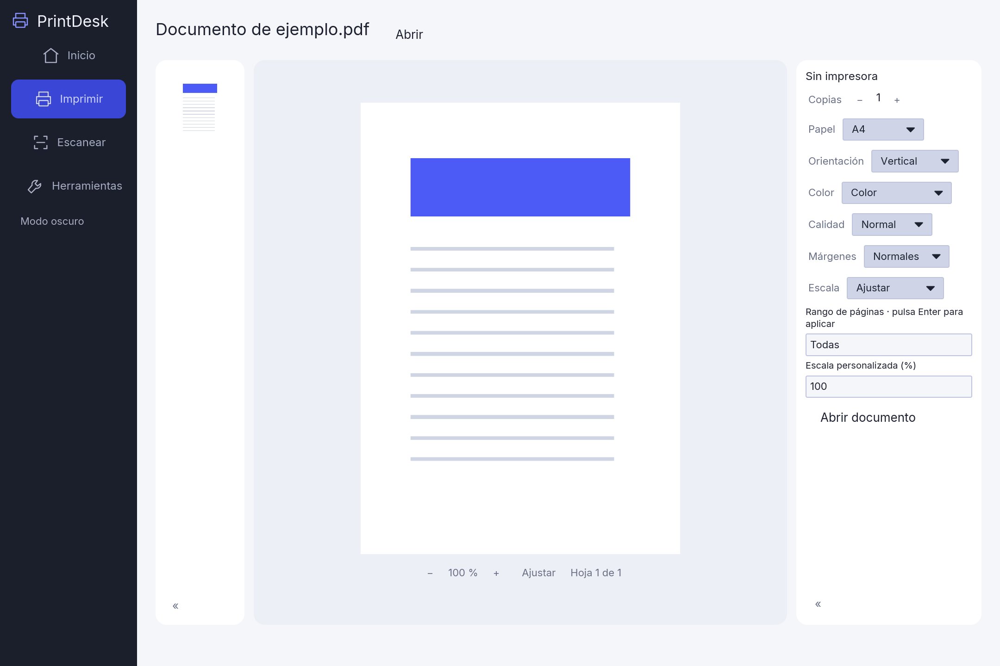
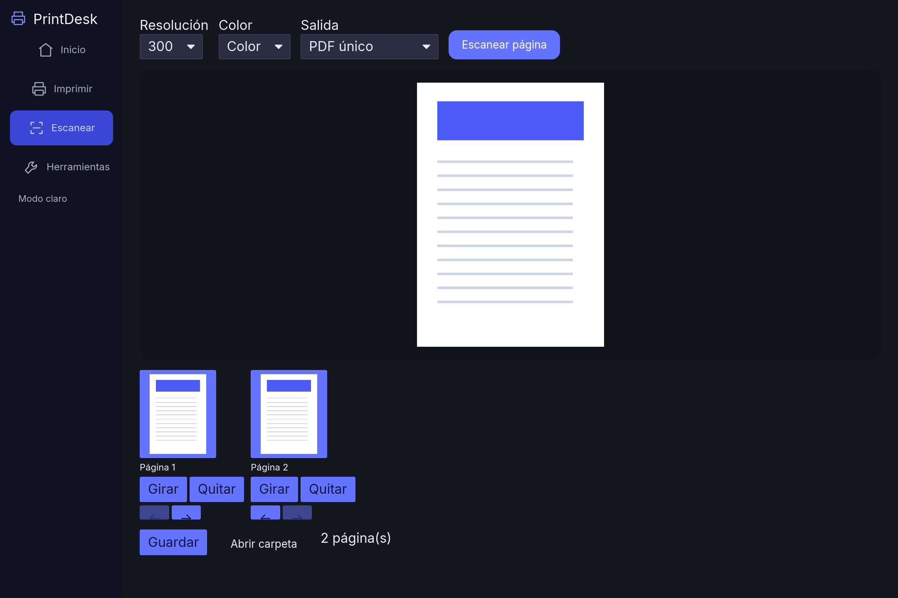
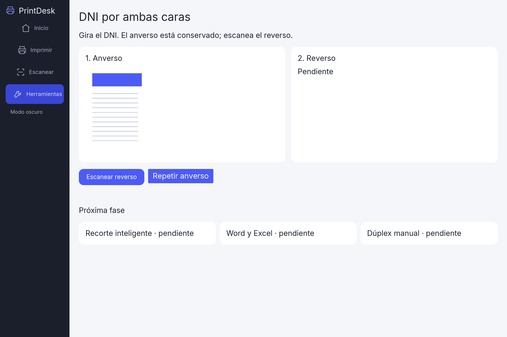
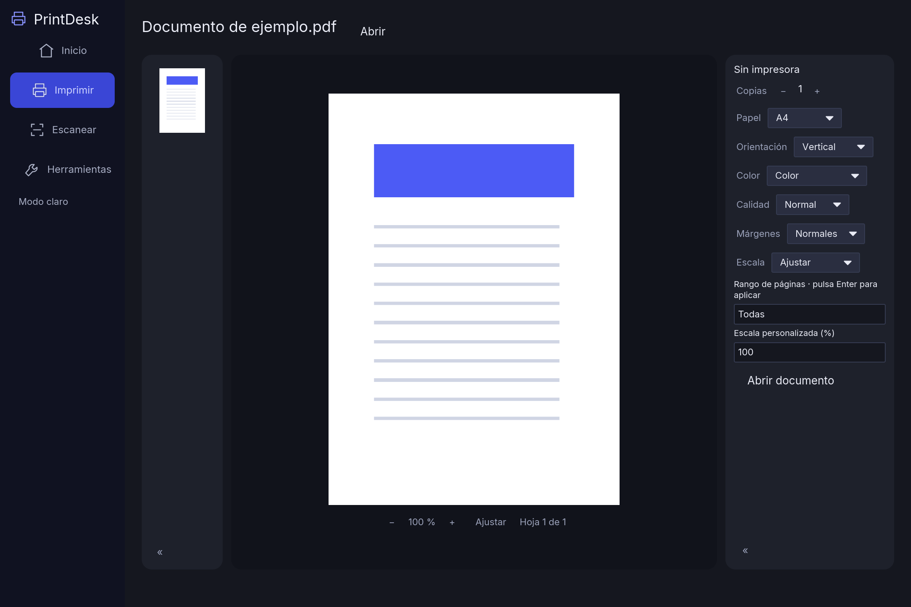

<p align="center">
  
</p>

# PrintDesk

**Imprime, escanea y prepara las dos caras de tu DNI desde una sola ventana.**

[](https://github.com/luizhuayta/epsonprint/actions/workflows/ci.yml)
[](https://github.com/luizhuayta/epsonprint/releases/latest)
[](LICENSE)


PrintDesk es una aplicación de escritorio para **Linux**, escrita en Rust con Iced y con interfaz en español. Utiliza las colas de impresión CUPS y los escáneres SANE que ya tienes configurados: no sustituye los drivers ni cambia la configuración del sistema.

La primera versión se ha probado con una **Epson EcoTank L375 por USB en Fedora**. Otros dispositivos compatibles con CUPS/SANE pueden detectarse, pero no están certificados por este proyecto.



*Capturas de la interfaz nativa con documentos sintéticos y sin un dispositivo conectado. No contienen escaneos ni datos personales.*

## Qué puedes hacer

- **Imprimir PDF, PNG y JPEG**: vista previa por hoja, miniaturas y opciones ocultables, zoom, papel, orientación, copias, color, calidad, márgenes, escala y rango de páginas.
- **Escanear varias hojas**: revisar cada página, girarla, quitarla y reordenarla con flechas o arrastre; guardar un PDF único o imágenes PNG/JPG.
- **DNI por ambas caras**: capturar el anverso, dar la vuelta al documento, capturar el reverso y guardar un PDF de dos páginas A4. Puedes repetir una cara si sale mal.
- **Inicio con estado y recientes**: consultar las colas y escáneres detectados, actualizar dispositivos y reabrir trabajos anteriores.
- **Modo claro y oscuro**: sigue el tema del sistema hasta que lo cambies manualmente; iconos locales y tipografía Inter incluida.

Las operaciones de impresión, escaneo y vista previa se ejecutan fuera del hilo de la ventana. El guardado habitual de escaneos evita sobrescribir archivos existentes y mantiene las páginas de la sesión disponibles para revisar.

<details>
<summary>Ver Escanear, Herramientas y el modo oscuro</summary>

### Escanear



### Asistente DNI



### Imprimir en modo oscuro



</details>

## Instalación

**La v0.1.0 se distribuye como código fuente.** Necesitas compilarla una vez; todavía no hay AppImage, Flatpak ni paquetes `.deb`/`.rpm`. La instalación de PrintDesk es solo para tu usuario, sin `sudo`.

### 1. Prepara tu sistema

Necesitas:

- Linux con Wayland o X11 y soporte gráfico compatible con wgpu.
- [Rust estable](https://rustup.rs/) **1.100 o posterior**, Git y herramientas de compilación.
- Los comandos `lp`, `lpstat`, `lpoptions`, `scanimage`, `timeout` y `xdg-open`.
- Tu impresora y escáner configurados previamente. PrintDesk **no instala controladores**.

<details>
<summary>Dependencias habituales en Fedora</summary>

```bash
sudo dnf install git gcc gcc-c++ make pkgconf-pkg-config libxkbcommon-devel wayland-devel mesa-libEGL-devel mesa-libGL-devel cups-client sane-backends xdg-utils
```

Los drivers específicos del dispositivo pueden requerir paquetes adicionales. Usa los que ya permiten imprimir y escanear desde tu sistema.

</details>

<details>
<summary>Dependencias habituales en Ubuntu 24.04</summary>

```bash
sudo apt update
sudo apt install git build-essential pkg-config libxkbcommon-dev libwayland-dev libclang-dev libegl1 libgl1 mesa-vulkan-drivers cups-client sane-utils coreutils xdg-utils
```

El CI comprueba compilación y pruebas en Ubuntu; la aceptación con una impresora física se realizó en Fedora. No equivale a certificar todos los equipos con Ubuntu.

</details>

Para comprobar que el sistema ve tus dispositivos:

```bash
lpstat -e
scanimage -L
```

Si no aparecen aquí, configura primero CUPS/SANE y el controlador correspondiente.

### 2. Descarga e instala

```bash
git clone --branch v0.1.0 --depth 1 https://github.com/luizhuayta/epsonprint.git printdesk
cd printdesk
bash instalar.sh
```

La primera compilación puede tardar varios minutos. Después busca **PrintDesk** en el menú de aplicaciones. El instalador crea:

- `~/.local/bin/printdesk` — ejecutable.
- `~/.local/share/applications/printdesk.desktop` — entrada del menú.
- `~/.local/share/icons/hicolor/scalable/apps/printdesk.svg` — icono.

Si tienes definido `XDG_DATA_HOME`, la entrada y el icono se instalan allí. También puedes descargar el código de [Releases](https://github.com/luizhuayta/epsonprint/releases), extraerlo y ejecutar `bash instalar.sh` desde esa carpeta.

## Primer uso

1. Conecta y enciende la impresora. Abre PrintDesk y pulsa **Actualizar dispositivos** si acabas de conectarla.
2. Para imprimir, entra en **Imprimir → Abrir**, elige un documento y revisa las opciones. Si editas el rango, pulsa **Enter** para aplicar los cambios antes de enviar el trabajo.
3. Para escanear, coloca una hoja en el cristal y pulsa **Escanear página**. Repite para añadir más hojas, revisa su orden y pulsa **Guardar**.
4. Para un DNI, entra en **Herramientas** y sigue las indicaciones de anverso y reverso. En esta versión cada cara ocupa una página A4; todavía no se recorta al tamaño de la tarjeta.

Los escaneos se guardan en `~/Escaneos/`. El historial está en `~/.local/share/printdesk/trabajos.json` o en `$XDG_DATA_HOME/printdesk/` si lo configuras. Los temporales de impresión usan una carpeta privada que se elimina al finalizar el envío.

**Los documentos no se suben a servicios externos.** Los trabajos se entregan a tu cola CUPS; si esa cola apunta a una impresora de red, CUPS usa esa conexión.

## Límites de esta versión

- Una cola que acepta trabajos **no garantiza conexión física, papel ni tinta**. No se inventan niveles de tinta.
- La L375 probada ofrece **Normal/Alta** para papel normal; no Borrador. Se utilizan las opciones reales de su controlador (`MediaType`, `Ink`, `PageSize`).
- El tamaño foto disponible es **4×6 pulgadas** (101,6 × 152,4 mm), no 100 × 150 mm exactos.
- La resolución se mantiene fija mientras haya páginas en una sesión de escaneo. Vacía la tira para cambiar los DPI.
- Con esta versión de Iced/winit, soltar archivos en la ventana depende del backend y no está disponible en Wayland. **Abrir** funciona en ambos.
- La vista previa representa papel, orientación, escala y márgenes; no simula la tinta ni la colorimetría de una impresora. Los trabajos se rasterizan y pueden ocupar más que el PDF original.
- Word/Excel, recorte inteligente y dúplex manual guiado quedan para una [segunda fase](docs/mejoras-futuras.md).

El [acta de aceptación](docs/acta-aceptacion.md) recoge las pruebas físicas y las comprobaciones aún pendientes. No se han certificado calidad Alta, impresión en gris, papel fotográfico ni documentos de cientos de páginas.

## Desinstalar

Estos comandos quitan la aplicación, pero **conservan tus escaneos y tu historial**:

```bash
rm -f "$HOME/.local/bin/printdesk"
rm -f "${XDG_DATA_HOME:-$HOME/.local/share}/applications/printdesk.desktop"
rm -f "${XDG_DATA_HOME:-$HOME/.local/share}/icons/hicolor/scalable/apps/printdesk.svg"
```

Si creaste un acceso directo adicional en el escritorio, elimínalo manualmente.

## Reportar un problema o contribuir

Abre un [issue](https://github.com/luizhuayta/epsonprint/issues/new) indicando distribución, versión de PrintDesk, modelo de impresora y pasos para reproducirlo. No adjuntes DNI, escaneos personales ni credenciales.

Consulta [CONTRIBUTING.md](CONTRIBUTING.md) para compilar, probar y enviar cambios. Las pruebas normales no consumen papel ni activan el escáner; las pruebas físicas requieren ejecución explícita.

## Licencia y créditos

Código de PrintDesk bajo [MIT](LICENSE). Inter se distribuye bajo [SIL Open Font License 1.1](assets/Inter-LICENSE.txt); las dependencias conservan sus licencias.

Construido con [Rust](https://www.rust-lang.org/), [Iced](https://iced.rs/), [exprim](https://crates.io/crates/exprim), [printpdf](https://crates.io/crates/printpdf), [CUPS](https://openprinting.github.io/cups/) y [SANE](http://www.sane-project.org/).
